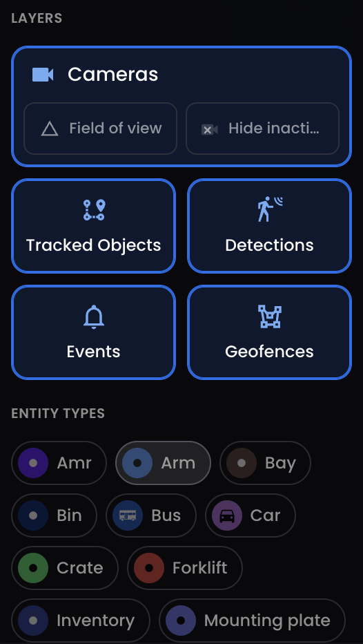
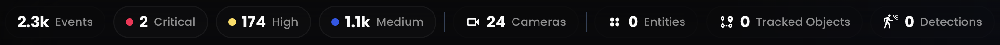
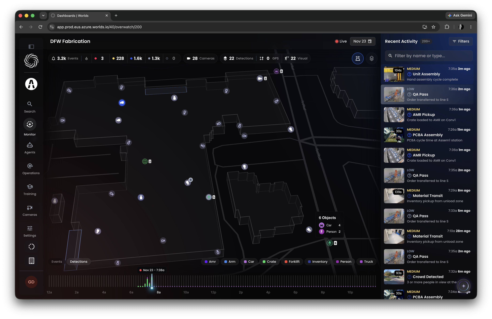
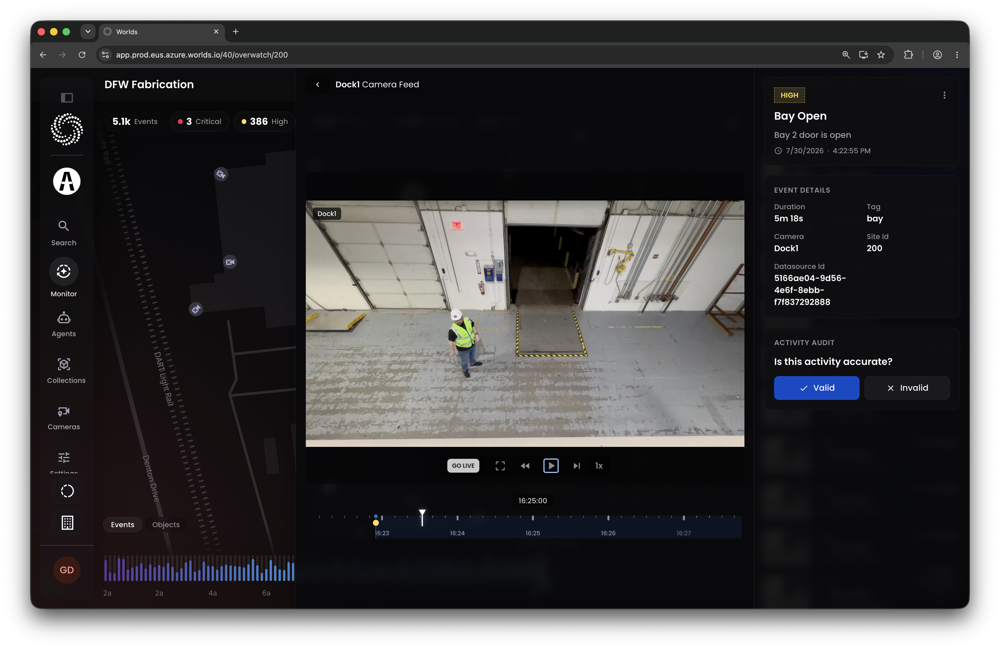

Overwatch is Worlds' primary view for spatial, live monitoring data, real-time events and object tracks laid over a map of your site.

## Before You Start

- Available to every role. Managers and Users only see data for sites they have permission to.
- The first time you open Overwatch, the first site in your organization loads automatically. If you have access to multiple sites, the site name in the top left becomes a dropdown to switch between them.

## Getting Oriented

Overwatch shows one day of data at a time. The live indicator next to the date at the top of the screen blinks when new data is actively streaming in, new events appear at the top of the event list on the right and highlight the camera that detected them.

Click the date in the top right to open a date picker and review a full day's worth of past Overwatch data.

**Tip:** When you load a site, the map should center and zoom to it automatically. If the default zoom isn't right, that's controlled by the site's **Site Bounds** in [Builder](/sites-and-cameras/builder), adjust the bounds there to change what Overwatch defaults to.

## Top Metrics

Across the top of the screen:

- **Total events** for the selected date
- **Heatmap** - turns the [event heatmap](#event-heatmap) on or off
- **Events by priority** - Critical, High, Medium, and Normal (events with no priority set)
- **Camera count** associated with the site
- **Detections** - everything the site is currently tracking, broken into two categories:
  - **GPS** - devices reporting their own lat/long positions
  - **Visual** - objects detected by a calibrated camera and placed in lat/long space

The Detections badge and its GPS and Visual counts are interactive. Click one to show or hide that category on the map. The numbers reflect what is visible on the map right now, not everything loaded for the date, so they move as you toggle layers and object types. The priority badges work the same way: click one to show or hide events of that priority.

On a narrower window, some badges fold into **More event filters** and **More detection layers** menus so the top bar stays on one line.

**Note:** Normal is off by default, so events without a priority stay hidden until you turn it on from its badge or from **Filters > Priority** in the Recent Activity panel.

**Note:** These counts are of distinct objects, not of raw detection moments, and they leave out anything without position data, since an object with no position cannot be placed on the map. They also keep up with edits: delete or re-tag a track and the counts follow. When you're [inside a region](#going-inside-a-region), the event counts cover only that region.

<Frame>
  
</Frame>

## The Histogram: Events and Detections

The histogram along the bottom is interactive, click back in time to see events from that period. It's a quick way to see when activity is heaviest, on top of the right panel, which always keeps the most recent event at the top.

Switch the histogram between **Events** and **Detections** using the toggle at the bottom left of the map. Detections plots every detected object, the raw output of every live computer vision detector running on cameras at this site, not just posted events. Each object class gets its own color, and hovering any bar breaks that moment down class by class.

<Frame>
  
</Frame>

## Map Layers and Object Tracks

The layers icon in the top right of the map opens the layer controls, shown open in the screenshot at the top of this page.

- **Cameras** - show or hide cameras on the map, with options to hide inactive ones and to show each camera's field of view. Each field of view is measured from the camera's calibration, so it shows how far and how wide that camera really sees.
- **GPS Detections** and **Visual Detections** - toggled separately and drawn with different markers, so you can bring up GPS-reported positions and camera-based detections independently.
- **Events** - show or hide events on the map.
- **Event Heatmap** - shade the map by where events have been happening (see [Event Heatmap](#event-heatmap)). Available while the Events layer is on.
- **Geofences** - show or hide the geofences configured for the site.
- **Floor Plans** - draw each building's floor plan under everything else on the map, useful for checking that cameras line up with the layout.

Where your deployment provides satellite imagery, a **Satellite** basemap option also appears at the top of the layer controls.

Under **Object Types**, enable individual object classes, populated from every unique class your models detect at this site, forklift or person for example, to see where that object has been seen over the course of the day. A type spans both categories, so toggling one filters GPS and visual detections alike. Each class carries the color it's drawn in on the map and in the Detections histogram.

**Perspective view** - the button beside the layers icon tilts the map and raises the buildings around your site in 3D. Buildings render transparent, so cameras, events, and tracked objects inside or behind a building stay visible and clickable. Click the button again to return to the flat, top-down view. Overwatch also remembers your layer selections the next time you open it.

**Tip:** Right-click and drag to pan and tilt the map for a clearer look at where objects and events sit. Right-clicking an object on the map opens a context menu of quick actions, so you can jump to its settings or details without leaving the spatial view.

**Tip:** Loading a track pulls a large volume of data, give it a second to render after enabling one.

**Note:** Tracks are especially useful at larger sites, sometimes alongside GPS tracking devices and geofences for event logic. More commonly, though, event logic is tied to a specific camera, in which case that camera's tracks can only appear on the Overwatch map if the camera is calibrated. Calibration happens in [Builder](/sites-and-cameras/builder).

**Note:** Where Overwatch settings are enabled, the **Settings** icon in the top bar lets you choose how priority events behave on the map (fading after a set time, or staying active until someone validates them) and which layers show by default.

## Event Heatmap

The event heatmap shades the map by where events have been happening, from the start of the selected day up to the point you're viewing on the timeline, so you can see at a glance where activity is concentrating. Turn it on from the **Heatmap** badge at the top of the screen, or the **Event Heatmap** layer.

A legend in the top left shows the time window it covers ("Events so far today," "Events all day," or a specific time range once you scrub the timeline), how many events it includes, and a scale from fewer to more events. The heatmap follows your current filters, and it can only place events that carry a map location, so the legend notes how many events it couldn't show. Events get a location from calibrated cameras when the workflow that posts them attaches position data, the same requirement as the Events Map on [Event Intelligence](/monitoring/event-intelligence).

**Note:** The heatmap is part of the Events layer. Hiding events hides the heatmap too, and it comes back when you turn events on again.

## Going Inside a Region

Buildings and the areas inside them, such as zones, lines, or workstations, can be set up as regions in [Builder](/sites-and-cameras/builder). On the Overwatch map, a region you haven't gone into shows as a single marker with a count of what's inside it, carrying the alerts of the cameras that cover it.

Click a region on the map, or its marker, to go inside it:

- The map zooms to fit that building or area, and everything outside it fades back.
- Cameras and objects inside it show individually, and any smaller regions within it show as their own markers.
- Events, counts, the Events histogram, and the heatmap narrow to just the cameras mounted in, or calibrated to see into, that region. The Recent Activity panel reads **Events in** the region's name, with a **Show all site events** link to switch back to the whole site.
- A breadcrumb at the top shows where you are, for example, your site, then a building, then a zone. Click any level to jump back to it, click the x to leave the region, or press Esc to step up one level.

This makes it easy to drill from a whole site into a single building, line, or workstation, and see only the activity that matters there.

## The Recent Activity Panel

The **Recent Activity** panel on the right streams events and activity, with a running count for the selected date. While the live indicator is on, new events publish here as they're detected, and highlight the relevant camera as they appear.

Each card carries a thumbnail from the moment the event fired, its priority, how long ago it happened, and how long it lasted, so you can triage the list without opening anything.

Click any event to open its video and captured details, where you can also mark it **Valid** or **Invalid**.

- Validating takes one click.
- Invalidating lets you choose an existing reason or type a new one, plus add notes.

**Tip:** Valid/Invalid marks are useful two ways: teams splitting live-monitoring responsibility across a large site can see at a glance whether a teammate already reviewed an event, and the same data helps engineers tune detection logic and improve accuracy over time.

The small menu at the top of an event's detail panel links to its full record in [Event Activity](/monitoring/event-activity). Close the panel by clicking outside it or clicking the arrow in the top left.

Use the **Filter by name or type** field at the top of the panel to find an event, or click **Filters** for more powerful filtering: by activity, priority, camera, label, status, agent, or validation.

<Frame>
  
</Frame>

## Opening Things on the Map

Events are not the only thing with a detail panel. Clicking a tracked object, a detection, or a camera opens the same side panel, so you can follow something from the map without leaving the spatial view.

### Tracked Objects

Click a GPS-tracked object to open its **Tracked Object** panel:

- **Details** - what the object is and how it is identified
- **History** - the object's path for the selected day, drawn on its own map with a scrubber to move back and forth through it. This is the quickest way to answer where something has been over the course of a day.
- **Events** - the events this object was involved in, so you can go straight from an object to what it triggered

### Visual Detections

Click a camera-based detection to open its **Visual Detection** panel:

- **Details** - what was detected and when
- The **camera feed** for the moment it was seen, so you can confirm the detection against the footage without opening another view
- **Related events** - any events this detection contributed to

### Cameras

Click a camera to open its panel, which carries a filtered list of that camera's events. Start from a live camera, scan what has happened on that feed through the day, and jump straight back to the moment that matters, rather than filtering down from every event at the site.

## Common Uses

Overwatch works well for a quick check of recent activity, a review of a full day's events at a site, or digging into historical tracks. But its primary purpose is live monitoring: security and safety stakeholders, or really anyone whose job requires reacting to something in real time.

Filter down to the use case that matters (security, safety, whatever it is) and leave the live view running, on a desk monitor or a wall-mounted screen. That gives a team a single pane of glass to get alerted, investigate, and react quickly, a meaningful step up from the older model of a video wall that depends on someone happening to be watching the right camera at the right moment.

## Quick Reference

- **Access** - every role; Managers and Users limited to sites they have permission to
- **Live indicator** - blinking means new data is actively streaming; new events surface at the top of the list and highlight the source camera
- **Date picker** - review a full day of past data
- **Top metrics** - total events, events by priority (Critical, High, Medium, and Normal, which is off by default), the Heatmap toggle, camera count, plus Detections split into GPS and Visual; the badges are clickable map toggles
- **Histogram** - events over time, or switch to Detections for every detected object by class
- **Map layers** - cameras, camera field of view, GPS detections, visual detections, events, event heatmap, geofences, floor plans, and per-class object types; your selections are remembered
- **Perspective view** - tilts the map and raises transparent buildings in 3D, from the button beside the layers icon
- **Event heatmap** - where events have been happening from the start of the day to the timeline position, with a legend
- **Regions** - click into a building or area to see only its cameras and events; breadcrumb or Esc to step back out
- **Settings** - where enabled, event behavior and default map layers, from the top bar
- **Object tracks** - need a calibrated camera (from [Builder](/sites-and-cameras/builder)) to appear on the map
- **Recent Activity panel** - live event stream with thumbnails and priority; mark Valid/Invalid; search and filter by activity, priority, camera, label, status, agent, or validation
- **Detail panels** - tracked objects (details, day path with scrubber, related events), visual detections (details, camera feed, related events), and cameras (that camera's event list)
- **Primary use case** - live monitoring for security, safety, and any real-time response workflow
